  <!-- ==================== HEADER BANNER ==================== -->
  

   

  # ✦ Praneeth E ✦

  **Founder & CEO @ TruBill · AI & Data Science Undergrad · Full-Stack Developer**

   

  

   

  <!-- ==================== TECH STACK & ARSENAL ==================== -->
  <h3>💻 Tech Stack & Arsenal</h3>

  

    
    
    
    
    
    
     
    
    
    
    
    
    
  

   

  <!-- ==================== GITHUB STREAK ==================== -->
  <h3>📊 GitHub Streak</h3>

  

    
  

   

  <!-- ==================== TOP LANGUAGES ==================== -->
  <h3>🔤 Top Languages</h3>

  

    
  

   

  <!-- ==================== CONTRIBUTION ACTIVITY ==================== -->
  <h3>📈 Contribution Activity</h3>

  

    
  

   

  <!-- ==================== CONNECT WITH ME ==================== -->
  <h2>Connect With Me</h2>

  

    
    &nbsp;&nbsp;
    
    &nbsp;&nbsp;
    
  

